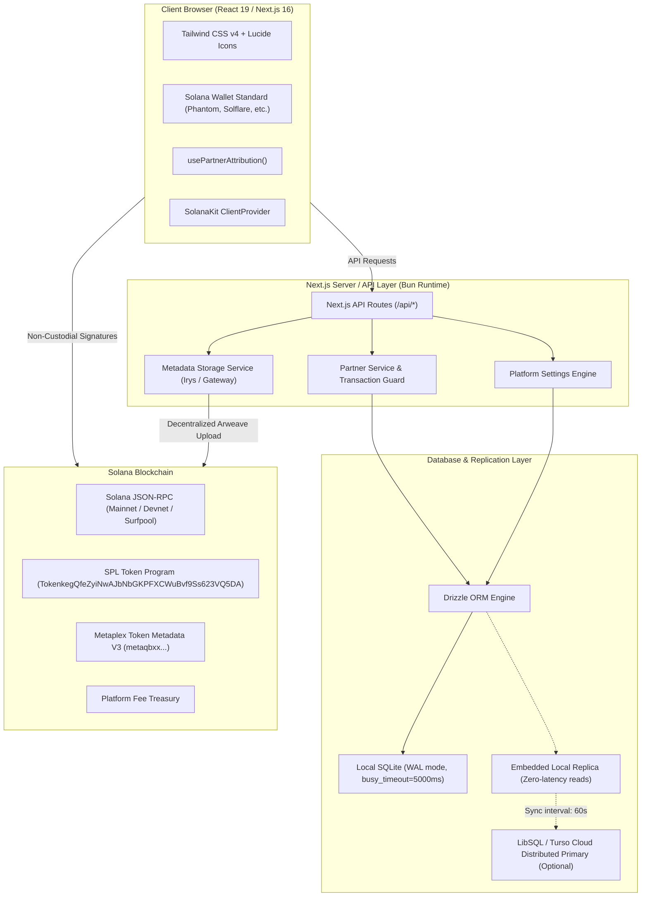

# Solana Token Studio — System Architecture

This document serves as the canonical architectural reference for **Solana Token Studio**. It describes the system design, non-custodial transaction model, database and replication architecture, data flow, and technology stack.

---

## 1. High-Level System Architecture

Solana Token Studio is an enterprise-grade, non-custodial decentralized application (dApp) built on Solana. It enables founders, creators, and developers to mint custom SPL tokens, manage token authorities, execute bulk airdrops, update on-chain metadata, and launch liquidity pools. The platform also embeds a full-featured partner affiliate system with real-time conversion tracking and payouts.

---

## 2. Core Architectural Pillars

### 2.1. Strictly Non-Custodial Security Model
- **No Private Keys on Server**: The backend **never** receives, handles, signs, or stores user private keys or seed phrases.
- **Client-Side Construction & Signing**: All transactions (token creation, minting, revoking authorities, airdropping tokens, burning, transferring SOL) are constructed and signed strictly client-side via `@solana/kit` and standard Solana wallet adapters (`@solana/react`, `@wallet-standard/wallet`).
- **Verifiable On-Chain Execution**: Platform fees are collected through transparent on-chain system program transfer instructions appended directly to the transaction message before wallet signing.
- **Rent Exemption Absorption**: When enabled in platform settings, the platform treasury calculates the exact rent-exemption lamports required for the mint account and associated token accounts, transparently bundling the required lamports so users enjoy zero hidden costs.

### 2.2. Enterprise Database & Replication Architecture (LibSQL + Drizzle ORM)
The database layer is engineered for instant local development and zero-downtime global scalability:

1. **Driver**: `@libsql/client` paired with `drizzle-orm/libsql`.
2. **Local Standalone Engine**:
   - Stores data in `data/solana_studio.db`.
   - Concurrency hardening: Automatically configures `PRAGMA busy_timeout = 5000;`, `PRAGMA journal_mode = WAL;`, and `PRAGMA synchronous = NORMAL;`.
   - WAL (Write-Ahead Logging) allows concurrent reads and non-blocking writes.
3. **Distributed Cloud & Edge Replication (Turso / LibSQL)**:
   - When `TURSO_DATABASE_URL` and `TURSO_AUTH_TOKEN` (or `LIBSQL_DATABASE_URL` / `LIBSQL_AUTH_TOKEN`) are configured in `.env`, the client operates in **Embedded Replica Mode**.
   - Reads execute locally off `data/replica.db` with sub-millisecond latency.
   - Writes are forwarded automatically to the primary distributed LibSQL cluster.
   - Background synchronization occurs automatically at a configurable interval (default: 60 seconds).
4. **Auto-DDL Table Bootstrapping**:
   - `ensureDbInitialized()` in `app/lib/db/index.ts` automatically runs `CREATE TABLE IF NOT EXISTS` and creates indexes on boot.
   - Zero migration ceremony required for local spins, Docker images, and ephemeral CI runners.
5. **Precision Arithmetic Guard**:
   - Financial SOL calculations in `app/lib/partner-service.ts` use `Math.round(val * 1000) / 1000` to prevent IEEE 754 floating-point drift (e.g. preventing `0.07500000000000001`).

---

## 3. Database Schema Overview

The database schema is defined in [`app/lib/db/schema.ts`](file:///p:/Solana/Solana-Token-Creation/app/lib/db/schema.ts):

| Table | Purpose | Key Indexes |
| :--- | :--- | :--- |
| `platform_settings` | Stores dynamic platform fees, RPC URLs, banner settings, treasury addresses, and maintenance toggles as a single-record JSON blob. | Primary Key: `id` ("default") |
| `partners` | Records all registered affiliates, custom commission tiers, audience discount rates, real-time counters (clicks, wallet connections, conversions), and balances. | `slug` (unique), `payout_wallet` (unique), `status` |
| `partner_conversions` | Immutable audit log of every paid transaction credited to a partner, recording transaction signature, gross fee, commission earned, and timestamp. | `partner_id`, `partner_slug`, `timestamp` |
| `partner_payouts` | Withdrawal requests submitted by partners, status tracking (`pending`, `completed`, `rejected`), and on-chain payout transaction signatures. | `partner_id`, `status` |

---

## 4. Technology Stack & Dependencies

| Layer | Technology | Version | Purpose |
| :--- | :--- | :--- | :--- |
| **Runtime & Package Manager** | Bun | latest | Fast TypeScript execution, test runner, and package management |
| **Framework** | Next.js (App Router, Turbopack) | 16.3.4 | Server-side rendering, React Server Components, API routes |
| **UI Library** | React | 19.2.3 | Modern concurrent UI components |
| **Styling** | Tailwind CSS v4 | ^4.0 | Next-generation utility-first styling |
| **Solana Core Engine** | `@solana/kit` | ^7.0.0 | Transaction message piping, keypair signers, instruction encoding |
| **Solana React Integration** | `@solana/react` | ^7.0.0 | React hooks for Solana wallet connection and cluster state |
| **Token Standard** | `@solana-program/token` | ^0.15.0 | SPL Token program instructions (mint, burn, setAuthority) |
| **System Program** | `@solana-program/system` | ^0.13.0 | System account creation and SOL transfers |
| **Metadata Program** | `@metaplex-foundation/mpl-token-metadata` | ^3.4.0 | Metaplex Token Metadata V3 instruction serialization |
| **Database ORM** | Drizzle ORM | ^0.45.4 | Type-safe SQL query builder |
| **Database Client** | `@libsql/client` | ^0.18.0 | SQLite / Turso distributed database client |
| **Decentralized Storage** | `@irys/upload` & `@irys/upload-solana` | ^0.0.15 / ^0.1.8 | Decentralized Arweave metadata and image storage |
| **Test Runner** | Vitest | ^3.2.0 | Unit and integration testing |
| **Icons & Notifications** | Lucide React & Sonner | ^1.61.0 / ^2.0.7 | Modern iconography and toast notifications |

---

## 5. RPC & Cluster Topology

The application supports dynamic cluster switching across:
1. **Solana Mainnet-Beta**: Production token minting and liquidity creation.
2. **Solana Devnet**: Free testing with faucet airdrops.
3. **Surfpool / Local Validator**: Local test sandbox for offline development and integration tests.

### Dynamic RPC Management
- Default RPC endpoints can be configured globally through the **Admin Control Center** (`/admin`), backed by `platform_settings`.
- Custom RPC endpoints can also be input by users directly from the UI header to bypass public RPC rate limits.
