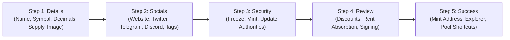
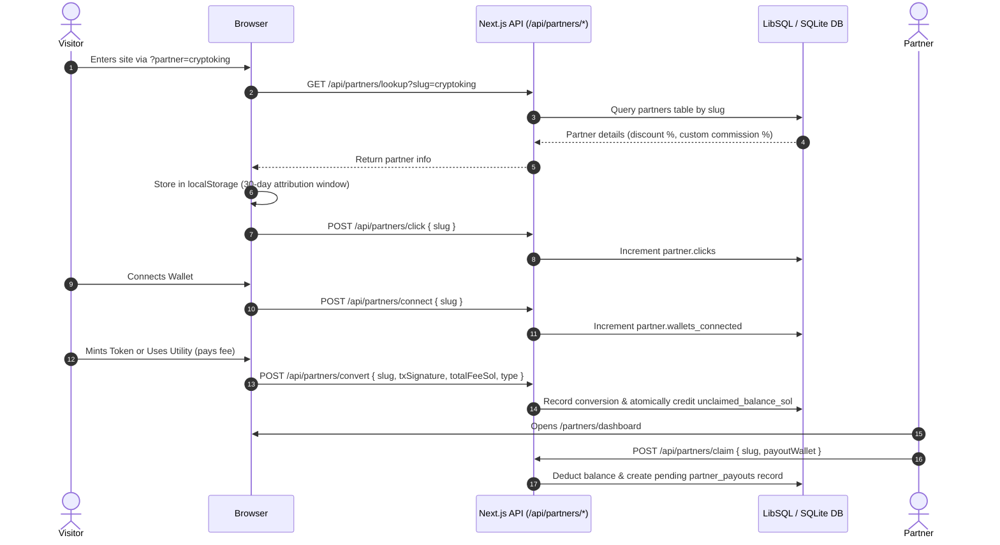

# Solana Token Studio — Modules & Features Guide

This guide provides deep technical documentation for each core subsystem in **Solana Token Studio**.

---

## 1. Token Creation Wizard

**Source Files:**
- [`app/components/wizard/token-wizard.tsx`](file:///p:/Solana/Solana-Token-Creation/app/components/wizard/token-wizard.tsx)
- [`app/components/wizard/steps/step-details.tsx`](file:///p:/Solana/Solana-Token-Creation/app/components/wizard/steps/step-details.tsx)
- [`app/components/wizard/steps/step-socials.tsx`](file:///p:/Solana/Solana-Token-Creation/app/components/wizard/steps/step-socials.tsx)
- [`app/components/wizard/steps/step-authorities.tsx`](file:///p:/Solana/Solana-Token-Creation/app/components/wizard/steps/step-authorities.tsx)
- [`app/components/wizard/steps/step-review.tsx`](file:///p:/Solana/Solana-Token-Creation/app/components/wizard/steps/step-review.tsx)
- [`app/components/wizard/steps/step-success.tsx`](file:///p:/Solana/Solana-Token-Creation/app/components/wizard/steps/step-success.tsx)
- [`app/components/preview/token-preview-card.tsx`](file:///p:/Solana/Solana-Token-Creation/app/components/preview/token-preview-card.tsx)
- [`app/lib/solana-token-creator.ts`](file:///p:/Solana/Solana-Token-Creation/app/lib/solana-token-creator.ts)

### Step-by-Step Flow

### 1.1. Step 1: Token Details
- Collects `name`, `symbol` (e.g. `BONK`), `decimals` (default: 9, customizable 0-9), `supply` (human-readable string e.g. `1000000000`), and `description`.
- **Image Upload & Compression**: Client-side canvas compression (`app/lib/image-compressor.ts`) compresses logos to WebP/PNG under 100KB before uploading to decentralized Arweave storage via Irys.

### 1.2. Step 2: Social Links & Tags
- Stores `website`, `twitter`, `telegram`, `discord`, and customizable tag chips (e.g., `MEME`, `DEFI`, `UTILITY`, `AI`).
- Serialized into standard off-chain Metaplex metadata JSON standard.

### 1.3. Step 3: Authority Revocations
- **Revoke Freeze Authority**: Critical for meme coins and DEX liquidity; prevents the creator from ever freezing token holder accounts.
- **Revoke Mint Authority**: Caps the initial supply permanently, ensuring no additional tokens can ever be minted.
- **Revoke Update Authority**: Immutably locks the token name, symbol, and metadata permanently on-chain.

### 1.4. Step 4: Review, Pricing & On-Chain Execution
- Dynamic fee calculation incorporating:
  - Base creation fee (e.g. 0.3 SOL)
  - Revocation fees (e.g. 0.1 SOL each)
  - Global promotional discount % (configured via Admin)
  - Partner referral discount % (via `usePartnerAttribution`)
  - Platform rent absorption (if enabled, Platform treasury absorbs rent costs)
- Constructs atomic transaction message using `@solana/kit`:
  1. `getCreateAccountInstruction` (allocates mint account with rent exemption)
  2. `getInitializeMintInstruction`
  3. `getCreateAssociatedTokenInstruction` (allocates creator's ATA)
  4. `getMintToInstruction` (mints total supply into creator's ATA)
  5. `createMetadataAccountV3` (registers Metaplex on-chain PDA metadata)
  6. Optional `getSetAuthorityInstruction` for Freeze and Mint
  7. Optional platform fee transfer to `treasuryWalletAddress`
- Signs with new mint keypair and user wallet signer in one atomic transaction.

### 1.5. Step 5: Post-Mint Launch Hub
- Displays mint address with copy and explorer buttons (Solana Explorer, Solscan).
- Offers quick 1-click launch buttons to create liquidity pools on Raydium or Meteora.

---

## 2. Post-Launch Utilities Suite

Located under `app/components/actions/` and powered by `app/lib/solana-token-utilities.ts` and `app/lib/solana-airdrop-utilities.ts`.

### 2.1. Batch Multi-Sender Airdrop (`airdrop-multi-sender-card.tsx`)
- **Dual Mode**: Supports both native SOL distributions and any custom SPL token airdrops.
- **Input Parsing & Validation**:
  - Accepts CSV, comma, tab, or space-separated lists (`address,amount` or `address amount`).
  - Strict Base58 public key validation with error highlighting per row.
  - Automatic duplicate address detection and summation or deduplication warnings.
- **Transaction Batching**:
  - Native SOL: **15 recipients per transaction**.
  - SPL Tokens: **8 recipients per transaction** (to stay within the 1232-byte legacy transaction size limit while including ATA idempotent creation instructions).
- **Safe Execution**: Uses `getCreateAssociatedTokenIdempotentInstruction` to ensure recipients without an existing ATA have one created automatically without failing if it already exists.

### 2.2. Standalone Authority Revoker (`authority-revoker-card.tsx`)
- Allows any token creator to inspect an existing mint and revoke:
  - **Freeze Authority** -> `AuthorityType.FreezeAccount = null`
  - **Mint Authority** -> `AuthorityType.MintTokens = null`
  - **Update Authority** -> Metaplex metadata update instruction setting `isMutable: false` and authority to null address.

### 2.3. Metadata Updater (`metadata-updater-card.tsx`)
- Fetches existing Metaplex metadata from the on-chain PDA (`metaqbxxUerdq28cj1RbAWkYQm3ybzjb6a8bt518x1s`).
- Verifies connected wallet matches `updateAuthority`.
- Allows updating Token Name, Symbol, and off-chain Metadata URI.

### 2.4. Token Burner (`token-burner-card.tsx`)
- Executes `getBurnCheckedInstruction` to safely burn tokens directly from the connected wallet's ATA.
- Permanently decreases total on-chain supply and displays updated supply in real time.

### 2.5. DEX Liquidity Launcher (`dex-launcher-card.tsx`)
- Step-by-step pool creation walkthroughs and pre-populated links for:
  - **Raydium CPMM & AMM V4**
  - **Meteora DLMM**
  - **DexScreener & Birdeye** listing trackers

---

## 3. Partner & Affiliate Marketing Engine

**Source Files:**
- [`app/partners/page.tsx`](file:///p:/Solana/Solana-Token-Creation/app/partners/page.tsx): Partner information & application page.
- [`app/partners/dashboard/page.tsx`](file:///p:/Solana/Solana-Token-Creation/app/partners/dashboard/page.tsx): Self-serve affiliate analytics dashboard.
- [`app/lib/partner-service.ts`](file:///p:/Solana/Solana-Token-Creation/app/lib/partner-service.ts): Database service for partners, conversions, and payouts.
- [`app/lib/hooks/use-partner-attribution.ts`](file:///p:/Solana/Solana-Token-Creation/app/lib/hooks/use-partner-attribution.ts): Client-side attribution and cookie window hook.

### 3.1. Tracking & Attribution Lifecycle

### 3.2. Custom Commission Splits & Audience Discounts
- Each partner can have:
  - `customCommissionPercent`: Overrides platform default (e.g., 35% for VIP partners vs 25% standard).
  - `audienceDiscountPercent`: Exclusive discount applied automatically at checkout for that partner's audience (e.g., 10% off token creation fees).
- Configurable per-partner via the **Admin Control Center**.

### 3.3. Payout Settlement
- Partners submit self-serve withdrawal requests when their unclaimed balance exceeds the minimum threshold (default: 0.05 SOL).
- Admins review pending claims in `/admin`, execute the SOL transfer, paste the transaction signature, and mark the payout as `completed`.

---

## 4. Admin Control Center

**Source Files:**
- [`app/admin/page.tsx`](file:///p:/Solana/Solana-Token-Creation/app/admin/page.tsx)
- [`app/api/admin/settings/route.ts`](file:///p:/Solana/Solana-Token-Creation/app/api/admin/settings/route.ts)
- [`app/api/admin/partners/route.ts`](file:///p:/Solana/Solana-Token-Creation/app/api/admin/partners/route.ts)
- [`app/lib/platform-settings.ts`](file:///p:/Solana/Solana-Token-Creation/app/lib/platform-settings.ts)

### 4.1. Access Security
- Admin endpoints require authentication via the `x-admin-key` header or query parameter, matched against `ADMIN_SECRET_KEY` in environment variables.

### 4.2. Capabilities
1. **Fee Management**:
   - Mainnet Base Fee (SOL)
   - Devnet Base Fee (SOL)
   - Authority Revocation Fees (Freeze, Mint, Update)
   - Standalone Utility Fees (Airdrop, Metadata Update, Standalone Revocation)
   - Rent Absorption Toggle (`absorbNetworkRent`)
   - Platform Treasury Wallet Address
2. **Growth & Marketing**:
   - Global Promotional Discount %
   - Announcement Banner text and active state
   - Referral program active state and default commission rate
3. **RPC & Infrastructure**:
   - Mainnet RPC endpoint override
   - Devnet RPC endpoint override
   - Maintenance mode toggle
4. **Partner Administration**:
   - Review pending partner applications
   - Approve / Reject partner applications
   - Set custom commission % and audience discount %
   - Inspect full conversion audit trail per partner
   - Settle payout requests with on-chain transaction hash verification

---

## 5. API Reference Matrix

| Route | Method | Description | Auth Required |
| :--- | :--- | :--- | :--- |
| `/api/settings` | `GET` | Fetches public platform settings (fees, discounts, banner) | No |
| `/api/admin/settings` | `GET`, `POST` | Fetches/updates sensitive platform settings | Yes (`x-admin-key`) |
| `/api/admin/partners` | `GET`, `POST` | Manages partners, approvals, splits, payouts | Yes (`x-admin-key`) |
| `/api/partners/apply` | `POST` | Submits partner application | No |
| `/api/partners/lookup` | `GET` | Looks up partner by slug or wallet address | No |
| `/api/partners/click` | `POST` | Records link click for partner attribution | No |
| `/api/partners/connect` | `POST` | Records wallet connection under partner referral | No |
| `/api/partners/convert` | `POST` | Records paid on-chain action and credits commission | No |
| `/api/partners/claim` | `POST` | Submits payout withdrawal claim for unclaimed earnings | No |
| `/api/upload-metadata` | `POST` | Uploads metadata JSON and images to Irys/Arweave | No |
| `/api/upload-metadata/status` | `GET` | Checks Irys upload node status and network balance | No |
