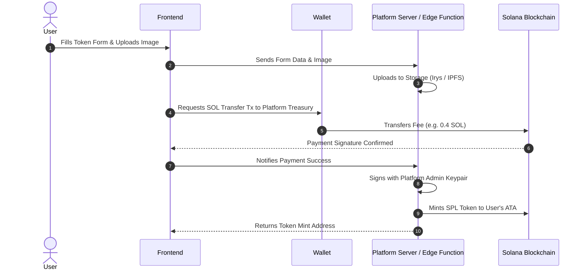
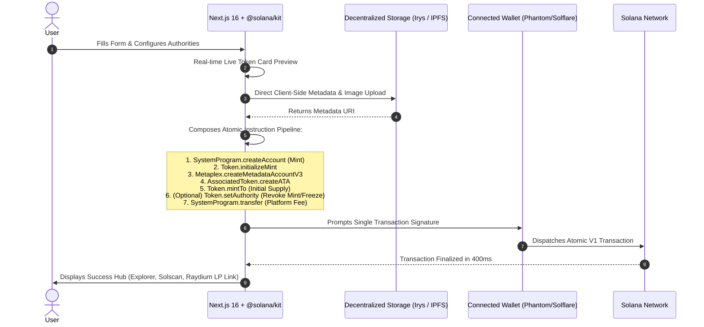

# Comprehensive Solana Token Creator Competitor Intelligence & Architecture Benchmark

**Version:** 2.0 (Deep Analysis)  
**Date:** October 2026  
**Analyzed Platforms (Live Inspection via Chrome DevTools & Source Code Audit):**

1. **Luna Launch** (`https://luna-launch.net/create-token.html` / `lunaregs.com` / `dex-lunadefi.com`)
2. **Smithii Tools** (`https://tools.smithii.io/token-creator/solana`)
3. **Orion Tools** (`https://www.oriontools.io/`)
4. **CoinFactory** (`https://coinfactory.app/generator/solana/spl-token`)
5. **DexLab Minting Lab** (`https://app.dexlab.space/token/create`)
6. **Pump.fun** (`https://pump.fun/create`)
7. **Existing Lovable Project** (`V:\solana-token-creation-lovable`)

---

## 1. Deep Architectural & Technical Comparison

| Dimension                      | Luna Launch                                                                            | Smithii Tools                                                                 | CoinFactory                                               | DexLab                                                               | Pump.fun                                                      | Existing Lovable App                                                        | **Our Proposed Platform**                                                       |
| :----------------------------- | :------------------------------------------------------------------------------------- | :---------------------------------------------------------------------------- | :-------------------------------------------------------- | :------------------------------------------------------------------- | :------------------------------------------------------------ | :-------------------------------------------------------------------------- | :------------------------------------------------------------------------------ |
| **Execution Architecture**     | **Custodial / Backend Relay** (User transfers SOL to platform receiver; backend mints) | **Non-Custodial Hybrid** (Client-side tx with Metaplex Umi / fee instruction) | **Custodial Relay** (Payment tx followed by backend mint) | **Non-Custodial Atomic** (Pure client-side single block transaction) | **Smart Contract / CPI** (Pump.fun program bonding curve CPI) | **Custodial Backend** (Supabase Edge Function mints using platform keypair) | **100% Non-Custodial Atomic** (Using modern `@solana/kit` v7 plugin pipeline)   |
| **Blockchain Client Tech**     | Vanilla JS + `@solana/web3.js` IIFE bundle + multiple RPC fallbacks                    | Next.js 14 + Metaplex Umi (`@metaplex-foundation/umi`)                        | Next.js + React Query + `@solana/web3.js` v1              | Custom Next.js + `@solana/web3.js`                                   | Custom React + `@coral-xyz/anchor` client                     | Vite + React 18 + Supabase Edge Functions + `@solana/web3.js`               | **Next.js 16 + React 19 + `@solana/kit` v7 + `@solana/react`**                  |
| **Token Standard**             | Legacy SPL Token                                                                       | SPL Token & Token-2022                                                        | Legacy SPL Token                                          | SPL & Token-2022                                                     | Pump Custom SPL                                               | Legacy SPL Token                                                            | **SPL Token with Metaplex V3 Metadata (+ Token-2022 Ready)**                    |
| **Metadata Storage**           | Centralized backend gateway (Luna host)                                                | Arweave / IPFS                                                                | IPFS / Centralized URL                                    | Arweave / Bundlr                                                     | IPFS (IPFS Gateway)                                           | Irys / Arweave via Edge Functions                                           | **Irys (Arweave) & IPFS with Live Fallback URL**                                |
| **RPC & Reliability Strategy** | Hardcoded QuikNode private RPC + 5 public fallbacks                                    | Distributed Alchemy & Helius RPC proxies                                      | Custom RPC proxy + public endpoints                       | Helius RPC node integration                                          | Private RPC cluster                                           | Supabase proxy RPC                                                          | **Configurable RPC + Multi-Cluster Switcher (Devnet/Testnet/Mainnet/Localnet)** |
| **Wallet Integration**         | Vanilla `window.solana` / `window.phantom` polling                                     | Solana Wallet Adapter (`@solana/wallet-adapter-react`)                        | Solana Wallet Adapter                                     | Multi-Wallet standard                                                | Dynamic Privy / Phantom SDK                                   | Solana Wallet Adapter                                                       | **Wallet Standard Auto-Discovery (`@solana/kit-plugin-wallet`)**                |
| **CSS & Design Engine**        | Vanilla CSS + inline styles + Yandex Metrika                                           | Tailwind CSS + Radix UI                                                       | Tailwind CSS + Custom SVG library                         | Tailwind CSS + Framer Motion                                         | Custom Dark Tailwind                                          | Tailwind CSS v3 + shadcn/ui                                                 | **Tailwind CSS v4 + shadcn/ui + Magic UI + UI/UX Pro Max**                      |

---

## 2. In-Depth Teardown: Pricing & Monetization Model

### Luna Launch (`luna-launch.net`)

- **Base Fee:** 0.2 SOL (Marketed with fake discount from 0.6 SOL to 0.3 SOL).
- **Authority Fees:**
  - Revoke Freeze: +0.1 SOL (Checked by default)
  - Revoke Mint: +0.1 SOL
  - Revoke Update: +0.1 SOL
- **Sneaky Upsell:** **Creator Info**: +0.1 SOL. _If unchecked, the platform permanently writes "Luna Launch" into the on-chain metadata as the creator!_
- **Add Social Links & Tags**: +0.1 SOL extra.
- **Total Max Monetization:** Up to **0.60–0.70 SOL** per token.

### Smithii Tools

- **Base Fee:** 0.50 SOL flat.
- **Authority Fees:**
  - Revoke Freeze: +0.10 SOL
  - Revoke Mint: +0.10 SOL
  - Revoke Update: +0.10 SOL
- **Total Max Monetization:** **0.80 SOL** per token (Highest in market).
- **Value Justification:** Heavy audit branding (Halborn, CoinFabrik), 25k+ tokens created proof, Dune analytics live board.

### CoinFactory

- **Base Fee:** 0.20 SOL.
- **Authority Fees:** +0.10 SOL each (Freeze & Mint marked as "Recommended for DEX safety").
- **Upsells:**
  - Custom Address / Vanity: +0.10 SOL
  - Personalized Token Page: Promoted upsell
  - Custom Creator Info: +0.10 SOL
- **Affiliate Revenue:** Built-in 30% affiliate revenue sharing link generator.

### DexLab Minting Lab

- **Base Fee:** ~0.15–0.25 SOL.
- **Authority Fees:** Bundled or modular.
- **Differentiation:** Offers real-time custom Vanity CA generation (prefix/suffix matching) directly in browser using Web Workers.

---

## 3. System Design & Transaction Flow Analysis

### Pattern A: Custodial Payment Relay (Luna Launch & Old Lovable)

> **Critical Flaw:** Centralized point of failure. If the backend fails between payment and minting, the user's SOL is gone and no token is created. Requires holding platform private keys on a server (security liability).

### Pattern B: Pure Non-Custodial Atomic Composition (Our Architecture)

> **Key Advantage:** 100% Trustless. If any instruction fails, the entire transaction reverts and the user never loses their funds. The creator directly owns the token mint keypair from genesis.

---

## 4. UI/UX & Trust Design Breakdown

### What Competitors Got Wrong:

1. **Luna Launch**:
   - Outdated vanilla CSS, intrusive Yandex/Google tracking scripts.
   - Punishes users with a fee to remove the platform's watermark from creator info.
   - Lack of real-time form validation and zero live preview.
2. **Smithii**:
   - Bloated navigation sidebar makes the token creation page feel like an enterprise ERP.
   - No visual preview of how the token will appear on Phantom or DexScreener.
3. **CoinFactory**:
   - Cluttered with excessive banner ads and promotional badges ("Hot", "New", "Promo").
   - Generic bright blue button design that looks like a 2018 web template.

### What Competitors Got Right:

1. **DexLab**:
   - **Live Token Preview Panel**: Updating ticker, symbol, name, and image in real time.
   - Vanity address generator with "Random" re-roll button.
2. **Orion Tools**:
   - Clean, dynamic fee calculator that updates in real time as toggles are flipped.
3. **CoinFactory**:
   - Dual-input logo option: Drag-and-drop local file OR enter an existing image URL.

---

## 5. Blueprint for Our Application (`Solana-Token-Creation`)

Using the intelligence gathered across all 7 platforms and following our **UI/UX Pro Max** design guidelines:

### Visual Language:

- **Style**: Modern Swiss Web3 Minimalism — Dark obsidian/void slate (`#080C14`), crisp borders (`#1F2B44`), elevated slate cards (`#131B2E`).
- **Accents**: Solana Emerald (`#10B981`) for trust badges + Warm Amber/Gold (`#F59E0B`) for action buttons. **No generic SaaS blue.**
- **Components**: shadcn/ui primitives + Magic UI glowing border beam on active cards.

### Core Features & Flow:

1. **Header & Global Trust Bar**:
   - Wallet Standard button with real-time SOL balance.
   - Network Switcher (Devnet, Testnet, Mainnet, Localnet).
   - Trust Badges: `[100% Non-Custodial]` `[Atomic Execution]` `[Permanent Arweave Storage]`.
2. **Split Screen Layout**:
   - **Left (60%)**: 4-Step Guided Wizard
     - _Step 1: Details_: Name, Symbol, Decimals (6 for Raydium/Memes, 9 for SPL standard), Total Supply, Description, Logo (Drag-and-Drop + URL switch).
     - _Step 2: Socials & Tags_: Website, Twitter/X, Telegram, Discord, Tag chips (`#Meme`, `#AI`, `#DeFi`).
     - _Step 3: Authority & Security Controls_:
       - Revoke Freeze (Checked by default with explanation: "Required for Raydium pools to ensure buyer trust").
       - Revoke Mint (Prevents inflation, caps supply).
       - Revoke Update (Makes metadata permanently immutable).
     - _Step 4: Fee Breakdown & Review_: Transparent calculation (Free on Devnet/Localnet; modest platform fee on Mainnet).
   - **Right (40%)**: **Live Interactive Token Preview**
     - Renders exact replica of Phantom Wallet token card + DexScreener banner preview.
     - Updates instantly as the user types or uploads an image.
3. **Success Launchpad Hub**:
   - Mint Address with 1-click copy & QR code.
   - One-click links: Solana Explorer, Solscan, DexScreener, Birdeye.
   - Direct button: "Create Liquidity Pool on Raydium".
